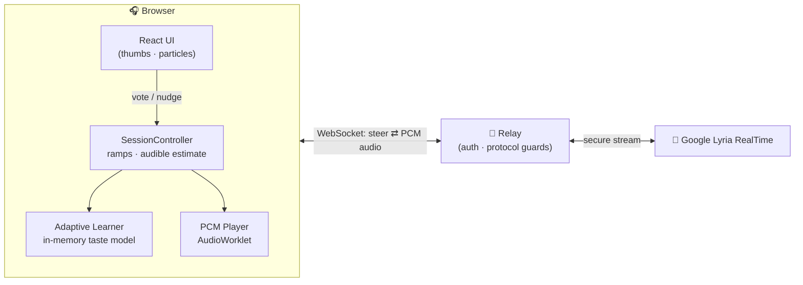

# Sway

An infinite instrumental stream that learns your taste. No skips, no playlists, no accounts — press play, vote 👍 or 👎, and the music keeps flowing while it adapts.

## The problem

Finding music that actually fits your taste is surprisingly hard. Recommendation engines infer what you like from skips, replays and listening history — guesses built on guesses. Playlists end, albums end, and every streaming session resets into "tell us your favorite artists." We wanted to know: **can a stream learn your taste from thumbs-up / thumbs-down alone, without ever interrupting the music?**

## The solution

Sway generates music live with **Google Lyria RealTime**. A small in-memory learner turns every vote into a weighted blend of musical features (genre, instrument, mood, texture) and steers the generation prompts toward it — cross-fading so playback never stops. Tap a word in the visualizer to lean the stream that way; like what you hear and it's saved as a moment you can return to.

- 👎 uses prepared audio when ready, with a 100 ms crossfade; otherwise it steers over ~2.5 s plus generation and playback-buffer delay
- Learns only from explicit feedback; silence never becomes evidence
- Preferences persist per-purpose in your browser (IndexedDB) — nothing leaves the device except the stream
- The whole session is visualized live: a WebGL2 particle field that breathes with the actual audio

## Resources

| What | How we used it |
|---|---|
| **Google Lyria RealTime** | Live instrumental generation; steered by weighted prompts |
| **NVIDIA Nemotron** | A team of agents at a larger scope: they interpret listener intent — free-text vibes, word taps and vote context — map it onto the musical feature vocabulary that steers Lyria, and review each session's outcome (below) |
| **Crusoe Cloud** | GPU inference serving the Nemotron agents — the LLMs stay hosted models, not a per-user download |
| **TypeScript + Vite + React** | Browser app, session controller, learner, visualizer |
| **WebSocket relay (Node)** | Keeps the API key server-side; guards the wire protocol |
| **Render** | Hosts the relay + built app (`render.yaml`, auto-deploys `main`) |

## System improvement: recursive learning

The agent doesn't just react to votes — each vote recursively updates a persistent taste model, and every later decision is made *through* that model. A like strengthens the audible blend's features; a dislike redirects using accumulated preference + uncertainty; directional likes learn from the *difference* between the rejected and approved blend; three rejections widen the search space entirely.

The loop continues after the music stops. A team of Nemotron agents reviews every session: what held listeners' votes, which steers landed and which missed. They fold those findings back into their memory, then validate candidate changes against listeners the system has never seen — so improvements generalize to the next stranger, not just the last session.

Why it produces better outcomes:

- **Faster convergence** — each session needs fewer votes to reach "yours," because the model starts where the last one ended (per-purpose profiles in IndexedDB).
- **Audible responsiveness** — a 👎 is hearable in ~2.5 s, and the honest fill indicator waits for the real generated block, so listeners learn to trust the control.
- **Graceful recovery** — probes and wide-search escapes keep the stream out of local minima instead of circling the same sound.
- **Better for every listener, not the average** — taste lives per-user, per-purpose, on-device: Focus-you and Crazy-you are separate models.
- **Improvements that generalize** — post-session reviews are tested on unseen listeners before they ship, so a change has to work for strangers, not just the person who trained it.

## Architecture



While listening, two bounded streams prepare the next Like and Dislike choices. Vote → learner picks a target → matching prepared audio replaces playback with a 100 ms crossfade → the chosen stream resumes and the next pair is prepared. Unready, stale or failed candidates use the normal prompt-steering ramp.

Preparation uses extra generation and up to three provider sessions; `createBrowserController({ lookahead: false })` disables it. See [cache integration and measured latency](docs/adaptive-integration.md#main-integration-and-live-cache-verification--2026-10-17) for readiness conditions and test limits.

## Run

```sh
pnpm install --frozen-lockfile
cp .env.example .env     # GEMINI_API_KEY for live mode; or ?mock / MUSIC_MODE=mock
pnpm dev                 # vite + relay at :5173
pnpm test                # 430+ unit + e2e tests
pnpm typecheck && pnpm build
```

Live: [sway-relay.onrender.com](https://sway-relay.onrender.com) · Deploy notes: [docs/deploy-render.md](docs/deploy-render.md) · Deep dives: [docs/](docs/)

## Design rules we kept

- Feedback is **explicit only** — 👍/👎 and word taps. Skips, dwell, and behavior are never inferred.
- **The music never stops.** Every steer is a cross-fade; votes while connecting or reconnecting steer with zero learning weight.
- **Nothing leaves the browser** except the stream itself — memory is local, resettable, exportable.
